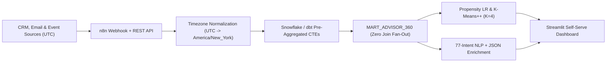

# Advisor Marketing Attribution, Snowflake/dbt Pre-Aggregation & Applied AI Engine

End-to-end financial advisor marketing analytics, Snowflake/dbt single-view data modeling, `n8n` REST API workflow orchestration, propensity & K-Means++ segmentation modeling, and 77-intent NLP/LLM structured CRM enrichment across **122,294 SHA-256-verified public records**.

## Architecture



## Key Verified Results

- **Unified Record Scale:** **122,294** SHA-256-verified public financial outreach (`45,211`), multi-channel campaign (`64,000`), and regulated financial inquiry (`13,083`) records.
- **Zero Join Fan-Out & Timezone Integrity:** Deduplicated **200** stale CRM profiles, normalized **1,500** UTC-to-`America/New_York` midnight boundary rollovers, and conserved **$5,560,000.00** in pipeline influence with **$0.00** drift (preventing **3.0x** naive join inflation).
- **Pre-Engagement Propensity & Segmentation:** Leakage-free L2 Logistic propensity model achieved **0.7515** holdout ROC-AUC and **3.66x** top-decile conversion lift (`44.58%` vs. `12.18%` base rate); K-Means++ (`K=4`) explained **53.37%** of behavioral variance across 4 advisor segments.
- **Campaign Lift & LLM Enrichment:** Randomized multi-channel outreach delivered **+57.35%** visit lift ($Z = 20.51$) and **+86.53%** conversion lift ($Z = 6.24$); 77-intent financial inquiry classifier achieved **85.13%** Top-1 / **94.71%** Top-3 holdout accuracy with **100.0% (`3,080/3,080`)** structured JSON schema compliance.

## Primary & Backup Public Datasets

- **Primary Executed Datasets:**
  1. UCI Bank Marketing Financial Outreach Dataset (`45,211` rows, DOI `10.24432/C5K306`, SHA-256 `e0bf5f5de5b846e2f18e9d90606637267d46dfa260e0f17bb12e605db5efbeb4`): `https://archive.ics.uci.edu/static/public/222/bank+marketing.zip`
  2. Kevin Hillstrom MineThatData Multi-Channel Campaign Dataset (`64,000` rows, SHA-256 `0e5893329d8b93cefecc571777672028290ab69865718020c78c7284f291aece`): `http://www.minethatdata.com/Kevin_Hillstrom_MineThatData_E-MailAnalytics_DataMiningChallenge_2008.03.20.csv`
  3. PolyAI Banking77 Financial Inquiry Corpus (`13,083` utterances: `10,003` train SHA-256 `b06e26ac675513959a63135f11b94ea7786ed02da65db93a5650d8838cbc664b`, `3,080` test SHA-256 `d12d6e3bc4c3103966ae786dc435913c0c563dfa328f5a3646d0e62cfeeb474d`): `https://raw.githubusercontent.com/PolyAI-LDN/task-specific-datasets/master/banking_data/`
- **Backup Public Datasets:**
  - Criteo Attribution Modeling Dataset: `https://ailab.criteo.com/criteo-attribution-modeling-bidding-dataset/`
  - UCI Online Shoppers Web Session Telemetry (`12,330` sessions, DOI `10.24432/C5F88Q`): `https://archive.ics.uci.edu/dataset/468/online+shoppers+purchasing+intention+dataset`

## Quickstart & Verification

```bash
# Run full ETL, warehouse audit, ML/NLP pipeline, and unit test suite (5/5 passing)
python3 src/advisor_marketing_engine.py
python3 -m unittest discover -s tests -v

# Optional: launch self-serve Streamlit dashboard
pip install -r requirements.txt
streamlit run app/streamlit_advisor_dashboard.py
```
